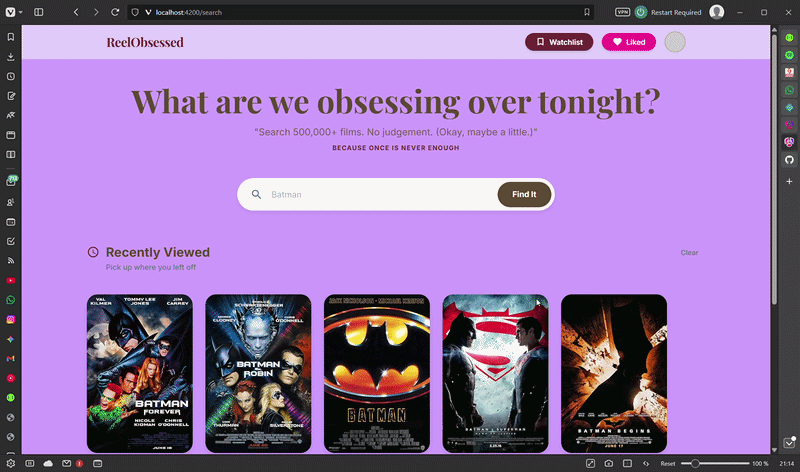
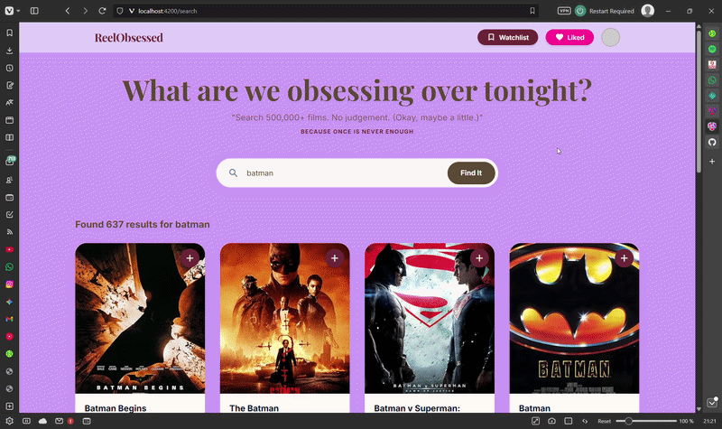
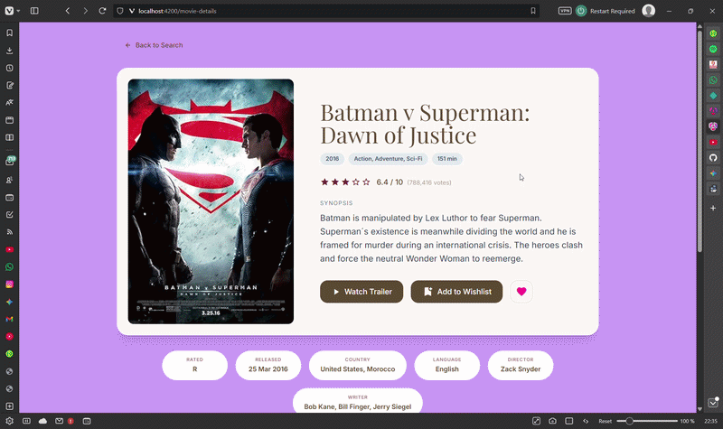
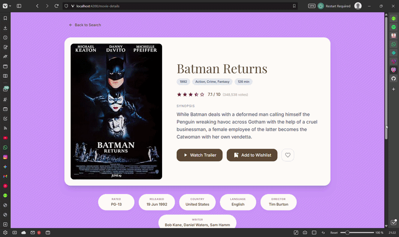

#  ReelObsessed

A feature-rich movie discovery app built with **Angular 21** and the **OMDb API**. Search for any movie, explore detailed info, like your favorites, and organize them into custom wishlists — all with a sleek dark/purple UI.

 **[Live Demo → reelobsessed.netlify.app](https://reelobsessed.netlify.app)**

---

##  Demo

**Search & Movie Details**



**Skeleton Loaders**



**Liked & Wishlist**



**Recently Viewed & Toast Notifications**


**Watch Trailer**



---

##  Features

-  **Movie Search** — Search millions of movies powered by the OMDb API with real-time results
-  **Movie Details** — Full details including plot, cast, genre, release year, runtime, ratings, and awards
-  **Star Rating Display** — IMDb ratings visually mapped to a 5-star scale with half-star precision
-  **Watch Trailer** — One-click redirect to YouTube trailer search for any movie
-  **Liked Movies** — Like/unlike movies and manage your collection on the Liked page
-  **Drag to Remove** — Swipe liked movie cards left to remove them with a smooth shake animation
-  **Wishlists** — Create multiple named wishlists and add any movie to them
-  **Recently Viewed** — Automatically tracks the last 10 movies you clicked on
-  **Load More / Pagination** — Load additional search results incrementally
-  **Skeleton Loaders** — Smooth loading placeholders while API results are fetched
-  **Toast Notifications** — Non-intrusive feedback for all user actions (success, info, warning, error)
-  **Persistent Storage** — Liked movies, wishlists, and recently viewed are saved in `localStorage`

---

##  Tech Stack

| Category | Technology |
|---|---|
| Framework | Angular 21 |
| Language | TypeScript 5.9 |
| Styling | SCSS |
| UI Components | Angular Material 21 |
| State Management | Angular Signals |
| HTTP | Angular HttpClient |
| Animations | Angular Animations |
| Drag & Drop | Angular CDK DragDrop |
| Movie Data | OMDb API |
| Build Tool | Angular CLI 21 |
| Testing | Vitest + JSDOM |

---

## Project Structure

```
src/
└── app/
    ├── components/
    │   ├── header/          # Navigation bar with route links
    │   ├── search-page/     # Main search interface with results grid
    │   ├── movie-details/   # Full movie info page with like/wishlist actions
    │   ├── liked/           # Liked movies list with drag-to-remove
    │   ├── wishlist/        # Multiple named wishlists manager
    │   ├── spinner/         # Global loading spinner
    │   └── toast-container/ # Toast notification display
    ├── services/
    │   ├── movie-service.ts         # OMDb API calls + shared signals
    │   ├── toast.service.ts         # Toast notification management
    │   └── error-handler.service.ts # Global HTTP error handling
    ├── interceptors/
    │   └── error.interceptor.ts     # HTTP interceptor for error handling
    ├── app.routes.ts        # Application routing config
    ├── app.config.ts        # App-level providers and config
    └── styles.scss          # Global styles
```

---

### Installation

```bash
git clone https://github.com/Gurushankar24/ReelObsessed.git
cd ReelObsessed
npm install
```

### Environment setup

This app uses the free [OMDb API](https://www.omdbapi.com/apikey.aspx). Get a key, then:

```bash
cp src/environments/environment.example.ts src/environments/environment.ts
```

Open `src/environments/environment.ts` and set `omdbApiKey` to your key.
This file is gitignored, so your key is never committed.

### Run

```bash
ng serve
```

Open http://localhost:4200


### Build for Production

```bash
ng build
```

Output will be in the `dist/` folder.

---

##  API

This project uses the free [OMDb API](https://www.omdbapi.com/) for movie data.

> To use your own key, replace the `apiKey` value in `src/app/services/movie-service.ts`.

---

## Angular Concepts Showcased

This project was built to practice and demonstrate real-world Angular patterns:

- **Signals** — Reactive state throughout using `signal`, `.set()`, `.update()`
- **Standalone Components** — Full standalone API, no NgModules
- **HTTP Interceptors** — Centralized error handling via `error.interceptor.ts`
- **Angular Animations** — Fade + slide-up on details page, shake + slide-out on card removal
- **CDK Drag & Drop** — Drag distance threshold detection for swipe-to-remove on liked movies
- **Angular Material** — Icons and UI primitives
- **Router with Child Routes** — Nested layout using `Header` as the parent route shell
- **LocalStorage Persistence** — All user data persisted across browser sessions

---


## Dev

**Gurushankar**
- LinkedIn: [linkedin.com/in/gurushankarv](https://www.linkedin.com/in/gurushankarv)
